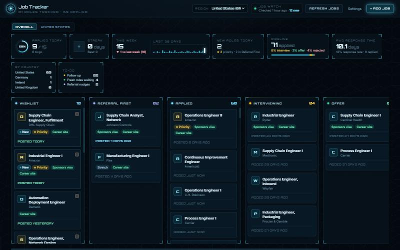

# Job Tracker

A local-first job application tracker with an AI job search built in. It keeps
every application on a Kanban board, and it goes out and finds new openings for
you, filtered down to roles you are actually eligible for.

Everything runs on your own machine. There is no account, no server and no API
key. The AI features call the Claude Code CLI you already have installed, so
there is no per-token bill.



> Add a screenshot at `docs/screenshot.png` to replace this placeholder.

## What it does

**Tracking**

- Six drag and drop stages: Wishlist, Referral First, Applied, Interviewing,
  Offer, Rejected.
- Each column sorts itself the way that column is used. Wishlist shows the
  newest posting first and ranks company career sites above job boards. Applied
  is alphabetical by company.
- Add a job by pasting its URL, which gets fetched and parsed for you, or by
  pasting the posting text.
- Multi-select with checkboxes and bulk delete.

**Job Watch, the AI search**

- Searches company career sites first, then runs broad discovery searches to
  surface employers you have not seen yet.
- Filters every result in code rather than trusting the model: drops postings
  older than 30 days, senior and level III+ titles, roles that refuse visa
  sponsorship, duplicates, and anything you previously deleted.
- Deleting a job records it, so no future search adds it back.
- Caps results at three per company and requires half from new employers, which
  stops a few large companies from flooding the board.
- Runs one merged session for the home country plus one per international
  country, because session count is what drives cost, not prompt size.

**Dashboard**

- Daily goal progress ring, streak, this week against last week, and a 30 day
  activity chart.
- Pipeline metrics: interview rate, offer rate, rejection rate and average
  response time.
- Action lists for follow ups, fresh roles and referral nudges.
- A toggle between overall numbers and a single country.

**Per application**

- Generate a tailored cover letter, rewritten resume bullets, likely interview
  questions, or a company brief, each using your saved resume as context.
- Job links open in whichever Chrome profile you choose, so you land already
  signed in.

## Tech

| Area | Choice |
| --- | --- |
| Framework | Next.js App Router, React, TypeScript |
| Styling | Tailwind, no component library |
| Drag and drop | `@dnd-kit`, with optimistic updates that roll back on failure |
| Database | SQLite via Node's built-in `node:sqlite`, no ORM, no native build step |
| AI | The local `claude` CLI as a subprocess, with web search enabled, returning strict JSON |
| Page parsing | Mozilla Readability, so a careers page is stripped to article text before any AI reads it |

## Getting started

Requires **Node.js 22.5+** (for the built-in SQLite module) and the
**[Claude Code CLI](https://claude.com/claude-code)** installed and logged in.
Check the CLI with:

```bash
claude --version
```

Then:

```bash
npm install
npm run dev
```

Open http://localhost:3000. The database is created automatically at
`data/app.db` on first run.

### Optional setup

- Paste your resume into **Settings → Profile**. Every generated document uses
  it as context.
- Set your target companies, roles and countries in **Settings → Discovery**.
- If `claude` is not on your PATH, copy `.env.example` to `.env.local` and set
  `CLAUDE_CLI_PATH` to the full path of the executable.
- On Windows, `launcher/` has a script that starts the server hidden, opens the
  app in its own Chrome window, and shuts the server down when you close it.

### Configuration worth changing

`src/lib/discovery/job-watch-defaults.ts` holds the search profile. Everything
in it is sample configuration, sketching one example hunt (early-career supply
chain and warehouse automation) so the app does something useful on first run.
Swap in your own:

- `GRADUATION_TERM`, which cohort the search targets.
- `REQUIRES_SPONSORSHIP`, off by default. Turn it on if you need an employer to
  sponsor a work visa, and Job Watch will skip postings that refuse
  sponsorship, require citizenship, or require a security clearance.
- `HOME_COUNTRY` and `DEFAULT_JOB_WATCH_COUNTRIES`, which markets to search.
  Leave the country list empty for a single-country search.
- The priority company list, searched hardest on every run, and the longer
  target list sampled on rotation.
- `DEFAULT_JOB_WATCH_ROLES`, the job titles to look for.

## Project layout

```
src/app/            Next.js routes and API handlers
src/components/     Board, KPI strip, job detail, settings UI
src/lib/            Data access, Job Watch search, KPI math, Claude CLI wrapper
src/lib/discovery/  Search prompts, filters and per-country visa rules
db/schema.sql       SQLite schema
scripts/init-db.ts  Schema setup and guarded migrations (backs up before changing)
launcher/           Windows desktop launcher
```

`CLAUDE.md` documents the architecture decisions and the gotchas worth knowing
before changing anything.

## Privacy

The app binds to `localhost` and is never deployed. Your resume, applications
and search history stay in `data/app.db` on your disk, which is gitignored.
The only outbound traffic is the page fetch when you add a job by URL, and
whatever the `claude` CLI sends during a search.

## License

MIT
